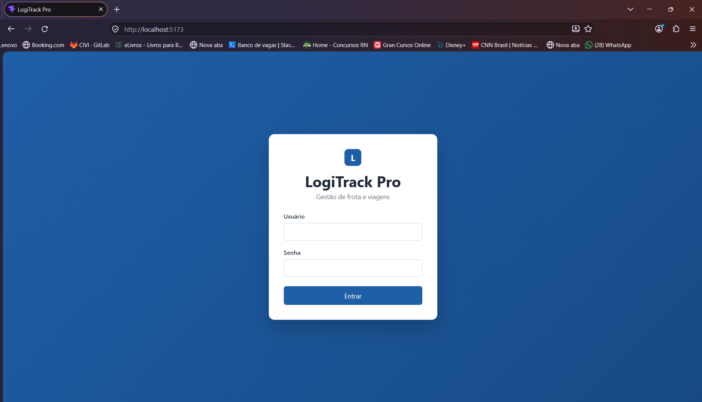
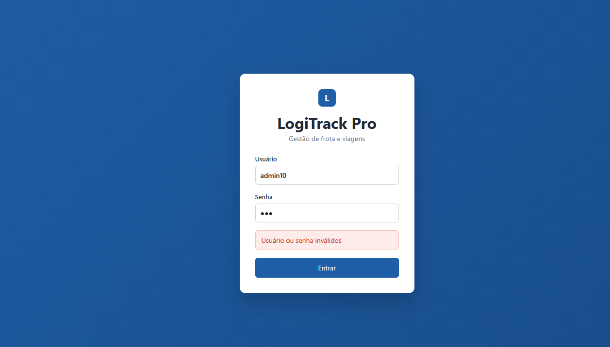
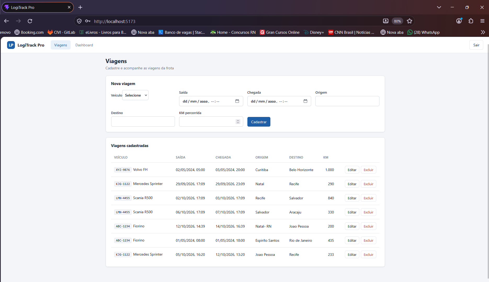
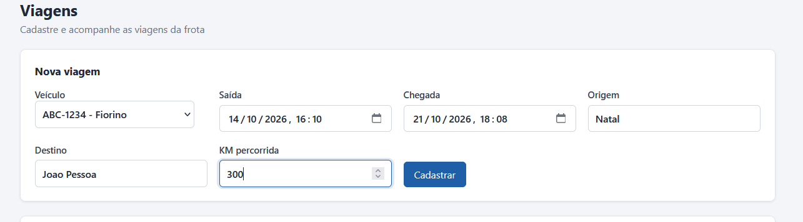
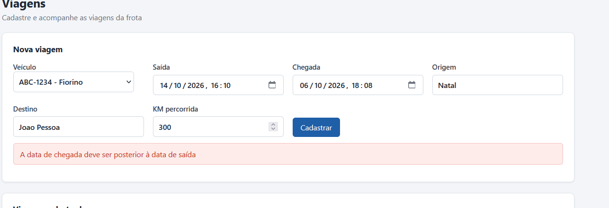
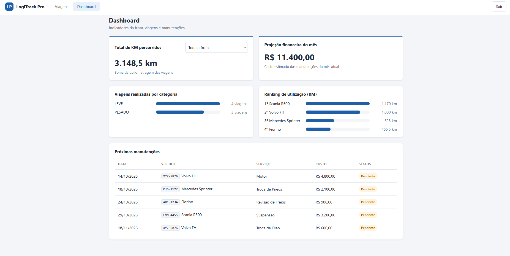
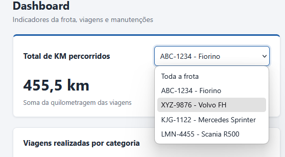

# LogiTrack Pro

Sistema de gestão de frota com **CRUD de Viagens** (módulo escolhido: Opção 1) e uma **área de relatórios** com 5 métricas extraídas via SQL.

- **Backend:** API REST em Java 21 + Spring Boot 4, com PostgreSQL
- **Frontend:** SPA em React (Vite)
- **Infra:** Docker Compose (banco + API + frontend)

Veja as telas e principais funcionalidades do sistema na seção de [Demonstração](#6-demonstração).

---

## 1. Como rodar o projeto

### Pré-requisitos

- [Docker](https://www.docker.com/) (com Docker Compose)

Não é necessário ter Java, Maven nem Node instalados: tudo é compilado dentro dos containers, para facilitar o teste.

### Passo a passo

**1. Subir tudo** (na raiz do repositório):

```bash
docker compose up --build
```

| Serviço | Porta | O que é |
|---|---|---|
| `db` | `5432` | PostgreSQL 16 |
| `api` | `8080` | API Spring Boot |
| `frontend` | `5173` | Build do React |

- Na primeira execução, o **Flyway** cria as tabelas e insere os dados automaticamente.
- A API só inicia depois que o banco estiver pronto.
- Lembrar de usar sempre `--build` após alterar o código, para as imagens serem recompiladas.

**2. Acessar:** http://localhost:5173

| Usuário | Senha |
|---|---|
| `admin` | `admin123` |

> Acesse por `localhost` (e não `127.0.0.1`): o CORS da API libera exatamente a origem `http://localhost:5173`.

### Rodar o frontend em modo de desenvolvimento (opcional)

Para editar o frontend com recarregamento automático (requer [Node.js](https://nodejs.org/) 20+), suba só o banco e a API e rode o Vite localmente:

```bash
docker compose up --build db api
cd frontend
npm install
npm run dev
```

Não deixe o container `frontend` rodando junto: ele ocupa a porta `5173`, o Vite sobe em outra porta e as chamadas são bloqueadas pelo CORS.

### Reiniciar o banco do zero

Os dados ficam em um volume do Docker. Para apagar tudo e recriar o banco (as migrations rodam de novo):

```bash
docker compose down -v
docker compose up --build
```

### Variáveis de ambiente da API

Já configuradas no `docker-compose.yml`. Só é preciso defini-las ao rodar a API fora do Docker.

| Variável | Padrão | Descrição |
|---|---|---|
| `DB_URL` | `jdbc:postgresql://localhost:5432/logitrack` | URL do banco |
| `DB_USER` / `DB_PASSWORD` | `postgres` / `postgres` | Credenciais do banco |
| `JWT_SECRET` | chave de desenvolvimento | Chave de assinatura do JWT (mínimo 32 caracteres). |
| `CORS_ORIGIN` | `http://localhost:5173` | Origem do frontend liberada no CORS |

O frontend usa `http://localhost:8080/api` por padrão. Pode ser alterado com a variável `VITE_API_URL`.

---

## 2. Endpoints da API

Todas as rotas, exceto o login, exigem o header `Authorization: Bearer <token>`.

| Método | Rota | Descrição | Sucesso |
|---|---|---|---|
| POST | `/api/auth/login` | Autentica e retorna o token JWT | 200 |
| GET | `/api/veiculos` | Lista os veículos | 200 |
| GET | `/api/viagens` | Lista as viagens | 200 |
| GET | `/api/viagens/{id}` | Busca uma viagem | 200 |
| POST | `/api/viagens` | Cria uma viagem | 201 |
| PUT | `/api/viagens/{id}` | Atualiza uma viagem | 200 |
| DELETE | `/api/viagens/{id}` | Exclui uma viagem | 204 |
| GET | `/api/dashboard?veiculoId=` | Retorna as 5 métricas (`veiculoId` opcional, filtra o total de KM) | 200 |

Códigos de erro: **400** (dados inválidos), **401** (sem token ou login inválido), **404** (viagem/veículo não encontrado) e **422** (regra de negócio violada).

Os erros usam a `ResponseStatusException` do próprio Spring, e o campo `message` da resposta traz o motivo (ex.: "Veículo já possui viagem no período informado"), exibido pelo frontend.

---

## 3. Arquitetura

### Backend: organização em camadas

```
backend/src/main/java/com/logitrack
├── config/       SecurityConfig: rotas públicas, CORS, API stateless
├── controller/   Recebe a requisição, valida (@Valid) e devolve DTOs. Sem regra de negócio
├── service/      Regras de negócio e transações (@Transactional)
├── repository/   Acesso a dados (Spring Data JPA + queries)
├── model/        Entidades JPA 
├── dto/          request, response e projection (resultado das queries do dashboard)
├── mapper/       Conversão entidade <-> DTO
└── security/     Geração/validação do JWT e filtro de autenticação
```

O fluxo de uma requisição é sempre **Controller → Service → Repository → Banco**.

Escolhi essa organização de camadas porque é familiar, fácil de navegar em um projeto pequeno e deixa explícita e organizada a responsabilidade de cada parte.

### Frontend

```
frontend/src
├── api.js            Função única de acesso à API (adiciona o token, trata erros e 401)
├── App.jsx           Alterna entre login e sistema; menu Viagens / Dashboard
└── pages/
    ├── Login.jsx
    ├── Viagens.jsx   Formulário + tabela (CRUD)
    └── Dashboard.jsx Indicadores, gráficos de barras e cronograma
```

Por não ser o foco, o frontend foi mantido propositalmente simples: sem bibliotecas além do React, navegação por estado e CSS puro.

No Docker, o frontend é compilado (`npm run build`) e os arquivos estáticos são servidos por um **nginx**, em um Dockerfile multi-stage, igual ao da API.

---

## 4. Decisões técnicas

### Ferramentas

| Ferramenta | Justificativa |
|---|---|
| **Spring Data JPA** | CRUD com pouco código; as entidades mapeiam as tabelas existentes |
| **Flyway** | Versionar o banco, importante também para documentar as mudanças feita em cima dele ( adicionei mais dados) |
| **Spring Security + JWT** | Autenticação stateless |
| **Lombok** | Reduz código repetitivo (getters/setters, construtores) |
| **Docker Compose** | Sobe banco, API e frontend com um único comando, sem instalar Java, Node nem Postgres. Requisito pedido no desafio. |

### Principais decisões

- **Entidades nunca são expostas na API.** A entrada e a saída usam DTOs, então as mudanças no banco não quebram o contrato com o frontend.
- **JPA no CRUD, SQL nativo no dashboard.** Produtividade onde há escrita e controle total nas consultas de relatório, como solicitado.
- ** `@EntityGraph`.** A listagem de viagens traz o veículo no mesmo `JOIN`, evitando o problema de N+1 consultas e lazy loading fora da transação.
- **Senhas com BCrypt.** O banco guarda apenas o hash.


### Regras de negócio das viagens

| Regra | Onde é validada | Erro |
|---|---|---|
| Campos obrigatórios e KM maior que zero | Bean Validation no DTO | 400 |
| O veículo deve existir | Service | 404 |
| A chegada deve ser posterior à saída | Service | 422 |
| A origem deve ser diferente do destino (ignorando maiúsculas e espaços) | Service | 422 |
| O veículo não pode ter viagens com períodos sobrepostos | Service + query | 422 |

A regra de **sobreposição** ataca diretamente o problema de "erros de agendamento" citado no desafio. Dois períodos se sobrepõem quando `inicioA < fimB` **e** `fimA > inicioB`. Na edição, a própria viagem é ignorada na verificação, para não conflitar consigo mesma.

A **data de chegada** foi tratada como obrigatória, pois faz parte do formulário descrito no desafio e simplifica a regra de sobreposição.

### Dashboard: as 5 métricas

Todas estão em `DashboardRepository`, com `@Query(nativeQuery = true)`.

As três métricas de viagens seguem a mesma regra: **só contam viagens realizadas**, ou seja, com `data_chegada <= agora`. Uma viagem agendada para o futuro ainda não teve seus quilômetros percorridos.

| Métrica | Interpretação adotada | Detalhe da query |
|---|---|---|
| **Total de KM** | Soma da KM das viagens realizadas (da frota ou de um veículo) | `COALESCE(SUM(...), 0)` para retornar 0 quando não há viagens; filtro de veículo opcional |
| **Volume por categoria** | Quantidade de viagens realizadas por tipo de veículo | `LEFT JOIN` com o filtro no `ON` e `COUNT(vi.id)`, para a categoria aparecer mesmo com 0 viagens |
| **Cronograma de manutenção** | As 5 próximas manutenções a partir de hoje, exceto as concluídas | `ORDER BY data_inicio LIMIT 5` |
| **Ranking de utilização** | Veículos ordenados pela KM das viagens realizadas (o 1º é o que mais rodou) | `GROUP BY` + `ORDER BY ... DESC LIMIT 5` |
| **Projeção financeira** | Soma do custo estimado das manutenções que começam no mês atual | Filtro por intervalo (`>= início do mês` e `< início do próximo`), sem aplicar função sobre a coluna |

---

## 5. Alterações no banco de dados

O script fornecido foi mantido e versionado com o **Flyway**, em `backend/src/main/resources/db/migration/`:

| Migration | Conteúdo |
|---|---|
| `V1__script_inicial.sql` | Script fornecido + criação da tabela `usuarios`
| `V2__dados_demonstracao.sql` | Viagens e manutenções com datas relativas ao dia de criação do banco (Os dados de v1 eram de 2024, e meu módulo escolhido não cria novas manutenções. Então adicionei novos dados, a paritr da data atual para popular a)|
| `V3__usuario_admin.sql` | Usuário padrão `admin` (senha em hash BCrypt) |

### Justificativas

**1. Tabela `usuarios` (adicionada na V1).** Já fiz de início essa adição, pois desde o começo pretendia fazer a autenticação, então por ser uma entidade central da api, já adicionei na v1.

```sql
CREATE TABLE usuarios (
    id SERIAL PRIMARY KEY,
    username VARCHAR(50) UNIQUE NOT NULL,
    password VARCHAR(100) NOT NULL, -- hash BCrypt
    role VARCHAR(20) NOT NULL DEFAULT 'ADMIN'
);
```

**2. Dados de demonstração com datas relativas (V2).** Os dados do script original são de **2024**. Como o cronograma mostra manutenções *futuras* e a projeção considera o *mês atual*, essas duas métricas ficariam sempre vazias, visto que o CRUD do módulo 1 não cria novas manutenções. A V2 insere manutenções e viagens usando `CURRENT_DATE + N` e `NOW() - INTERVAL`, para o dashboard ter dados em qualquer data de avaliação. 

**3. Usuário padrão (V3).** Permite acessar o sistema logo após subir o projeto (`admin` / `admin123`). A senha é gravada apenas como hash BCrypt.

Os dados originais do script foram mantidos sem alteração.

---

## 6. Demonstração

🎥 **Vídeo:** [Demo do app em Vídeo](https://drive.google.com/file/d/1_QZqRa-ch6X4zXrlOxkTcEgMxBnsauh2/view?usp=sharing)

### Login

Acesso com usuário e senha. Credenciais inválidas exibem uma mensagem de erro.





### Viagens (CRUD)

Formulário de cadastro e listagem das viagens, com ações de editar e excluir.





As regras de negócio são validadas pela API, e a mensagem é exibida no formulário. Exemplo: chegada anterior à saída.



### Dashboard

Indicadores da frota, gráficos de viagens por categoria e ranking de utilização, e o cronograma de manutenções.



O total de KM filtrado por veículo.



